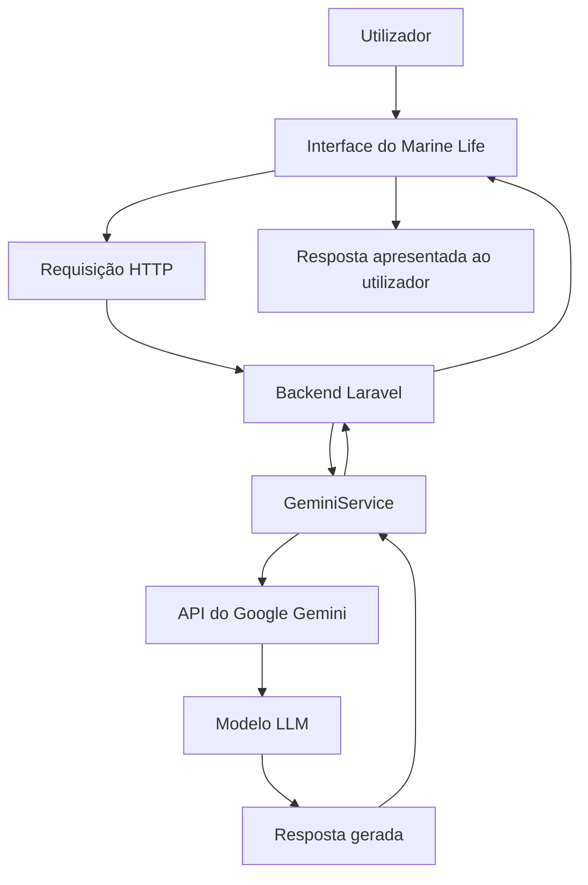

# 🌊 Marine Life

### Explorando a vida marinha com tecnologia e Inteligência Artificial

O **Marine Life** é uma aplicação web desenvolvida para facilitar o acesso a informações sobre a vida marinha, permitindo que os utilizadores pesquisem conteúdos relacionados com o ambiente oceânico e interajam com uma inteligência artificial para esclarecer dúvidas e explorar conhecimentos sobre os oceanos.

O projeto combina desenvolvimento web, integração de APIs e utilização de um **Large Language Model (LLM)** para criar uma experiência de pesquisa mais interativa, dinâmica e acessível.

> 🐠 **Objetivo:** aproximar as pessoas do conhecimento sobre a vida marinha através da tecnologia e da inteligência artificial.

---

## 📸 Sobre o projeto

O Marine Life foi desenvolvido com foco numa interface intuitiva, numa experiência de utilização simples e na integração de serviços externos capazes de ampliar as funcionalidades da aplicação.

Para além da interface visual e das funcionalidades tradicionais de pesquisa, o projeto explora a utilização de inteligência artificial generativa para interpretar perguntas em linguagem natural e produzir respostas contextualizadas.

## ✨ Funcionalidades

- 🔎 **Pesquisa:** interface dedicada à pesquisa de informações relacionadas com a vida marinha.
- 🤖 **Inteligência Artificial:** integração com um modelo de linguagem para responder a perguntas e gerar conteúdo informativo.
- 🌐 **Integração com APIs:** comunicação com serviços externos para ampliar as possibilidades da aplicação.
- 🪸 **Experiência interativa:** apresentação de informações de forma acessível e organizada.
- 📱 **Interface responsiva:** estrutura visual pensada para proporcionar uma boa experiência de utilização em diferentes tamanhos de ecrã.

*As funcionalidades apresentadas devem corresponder à versão efetivamente implementada no projeto.*

---

## 🧠 O destaque do projeto: integração com LLM

Uma das partes mais importantes do Marine Life é a integração com um **LLM (Large Language Model)**, um modelo de inteligência artificial treinado para compreender e gerar linguagem natural.

Para esta integração, foi utilizado o **Google Gemini**, através da sua API, permitindo que a aplicação envie perguntas para um modelo de IA e receba respostas geradas dinamicamente.

Ao contrário de um sistema baseado exclusivamente em respostas previamente escritas, esta abordagem permite que o utilizador formule perguntas de diferentes maneiras e obtenha respostas adaptadas ao conteúdo da sua solicitação.

### O que é um LLM?

Um LLM é um modelo de inteligência artificial capaz de processar linguagem natural, interpretar o contexto de uma solicitação e gerar texto com base nos padrões aprendidos durante o seu treino e nas instruções recebidas.

No Marine Life, esta tecnologia é utilizada para aproximar a interação com o sistema de uma conversa natural, tornando a exploração de informações sobre a vida marinha mais intuitiva.

### Porquê utilizar a API do Gemini?

A utilização de uma API de LLM permite integrar capacidades de inteligência artificial sem ter de desenvolver ou treinar um modelo de linguagem do zero.

Entre as principais vantagens desta abordagem estão:

- **Processamento de linguagem natural:** o utilizador pode formular perguntas sem precisar de utilizar comandos rígidos.
- **Geração dinâmica de respostas:** o conteúdo é produzido pelo modelo em função da solicitação recebida.
- **Integração com uma aplicação existente:** o modelo pode ser utilizado através de requisições HTTP a partir do backend.
- **Separação de responsabilidades:** a aplicação mantém a lógica de negócio no backend, enquanto o modelo é responsável pela geração das respostas.
- **Flexibilidade:** a integração pode ser ajustada ou substituída por outro fornecedor de LLM através de alterações na camada de serviço.

### 🔄 Como funciona a integração com a IA?

O fluxo de comunicação da aplicação pode ser representado da seguinte forma:



O processo funciona através das seguintes etapas:

1. **Entrada do utilizador:** o utilizador escreve uma pergunta ou solicitação na interface.
2. **Envio da requisição:** a aplicação envia os dados para o backend.
3. **Processamento no Laravel:** o backend recebe a solicitação e encaminha-a para o serviço responsável pela integração com a IA.
4. **Comunicação com o Gemini:** o `GeminiService` realiza a comunicação com a API do Google Gemini, enviando a pergunta ao modelo.
5. **Geração da resposta:** o LLM processa a solicitação e produz uma resposta em linguagem natural.
6. **Retorno ao backend:** a aplicação recebe a resposta da API e trata o resultado.
7. **Apresentação:** a resposta é devolvida à interface para ser apresentada ao utilizador.

Esta arquitetura mantém a comunicação com a API externa no backend, evitando expor diretamente a chave de acesso ao modelo no código do frontend.

### 🛠️ O papel do `GeminiService`

A criação de um serviço dedicado à comunicação com o Gemini permite centralizar a lógica de integração com a inteligência artificial.

O `GeminiService` funciona como uma camada de comunicação entre a aplicação Laravel e a API externa.

Esta separação oferece vantagens importantes:

- Centraliza as chamadas à API de IA.
- Evita espalhar a lógica de comunicação por diferentes partes do sistema.
- Facilita a manutenção e a identificação de erros.
- Permite ajustar parâmetros, tratamento de respostas e gestão de falhas num único local.
- Torna mais simples a futura substituição ou expansão da integração com modelos de linguagem.

Além disso, a utilização de um serviço dedicado ajuda a manter o código mais organizado e facilita a evolução da aplicação.

### ⚠️ Desafios da integração com LLM

A utilização de uma API de inteligência artificial também apresenta desafios técnicos.

Entre eles estão a latência das requisições, os limites de utilização da API, a disponibilidade do serviço externo, os erros de comunicação e a necessidade de gerir corretamente as credenciais.

Outro aspeto importante é que as respostas de um LLM podem conter informações incorretas. Por esse motivo, a inteligência artificial deve ser utilizada como ferramenta de apoio à exploração de conhecimento, e não como garantia absoluta de precisão científica.

---

## 🏗️ Arquitetura da aplicação

O Marine Life utiliza uma arquitetura cliente-servidor, separando a interface apresentada ao utilizador da lógica de processamento e das integrações externas.

De forma geral, a aplicação está organizada em três camadas:

**1. Frontend**

Responsável pela interface visual, pela interação com o utilizador e pela apresentação das informações.

**2. Backend**

Responsável pelo processamento das requisições, pela lógica da aplicação, pela comunicação com os serviços externos e pela gestão das respostas.

**3. APIs externas**

Responsáveis por disponibilizar funcionalidades e dados que não precisam de ser implementados integralmente dentro da aplicação.

Esta organização permite que cada parte do sistema tenha uma responsabilidade específica, facilitando a manutenção e a evolução do projeto.

---

## 💻 Tecnologias utilizadas

| Tecnologia | Utilização |
|---|---|
| PHP | Linguagem de programação utilizada no backend |
| Laravel | Framework responsável pela estrutura da aplicação, rotas e lógica de servidor |
| HTML5 | Estrutura das páginas |
| CSS3 | Estilização e organização visual da interface |
| JavaScript | Interatividade no frontend |
| Google Gemini API | Integração com inteligência artificial generativa |
| APIs externas | Integração com serviços de dados adicionais, conforme implementado no projeto |
| Git e GitHub | Controlo de versões e alojamento do código-fonte |

---

## ⚙️ Como executar o projeto localmente

### Pré-requisitos

Antes de começar, certifica-te de que tens instalado:

- PHP numa versão compatível com o projeto.
- Composer.
- Node.js e npm, caso sejam utilizados para compilar os recursos do frontend.
- Uma base de dados compatível com a configuração da aplicação, se necessária.
- Uma chave de API do Google Gemini.

### 1. Clonar o repositório

```bash
git clone URL_DO_REPOSITORIO
cd marine-life
```

Substitui `URL_DO_REPOSITORIO` pelo endereço real do repositório.

### 2. Instalar as dependências

```bash
composer install
```

Se o projeto utilizar dependências de frontend:

```bash
npm install
npm run build
```

### 3. Configurar o ambiente

Cria o ficheiro `.env` a partir do exemplo disponibilizado no projeto:

```bash
cp .env.example .env
```

Gera a chave da aplicação Laravel:

```bash
php artisan key:generate
```

### 4. Configurar as variáveis de ambiente

No ficheiro `.env`, adiciona as credenciais necessárias para os serviços utilizados.

Exemplo ilustrativo:

```env
APP_NAME="Marine Life"
APP_ENV=local
APP_DEBUG=true
APP_URL=http://127.0.0.1:8000

GEMINI_API_KEY=sua_chave_api
```

O nome `GEMINI_API_KEY` deve corresponder à variável efetivamente utilizada pelo serviço de integração. Se o código utilizar outro nome, ajusta esta configuração.

**Importante:** nunca publiques a tua chave de API no GitHub. O ficheiro `.env` deve permanecer fora do controlo de versões.

### 5. Configurar a base de dados

Se a aplicação utilizar uma base de dados, configura as respetivas credenciais no ficheiro `.env` e executa as migrações necessárias:

```bash
php artisan migrate
```

### 6. Iniciar a aplicação

```bash
php artisan serve
```

Por padrão, a aplicação estará disponível em:

```text
http://127.0.0.1:8000
```

---

## 🔐 Segurança e boas práticas

O projeto considera alguns princípios importantes para o desenvolvimento de aplicações que utilizam serviços externos:

- **Proteção das credenciais:** as chaves de API devem ser armazenadas em variáveis de ambiente.
- **Comunicação através do backend:** as chamadas a serviços privados devem ser realizadas no servidor, evitando a exposição de credenciais no navegador.
- **Tratamento de erros:** falhas de rede, respostas inválidas e indisponibilidade de serviços externos devem ser tratadas adequadamente.
- **Separação de responsabilidades:** a lógica de integração com a IA deve permanecer isolada num serviço dedicado.
- **Validação de entradas:** os dados recebidos do utilizador devem ser validados antes do processamento.

---

## 🚀 Melhorias futuras

O Marine Life pode continuar a evoluir através de funcionalidades como:

- Implementação de histórico de conversas com a inteligência artificial.
- Melhoria do tratamento de erros e dos tempos limite das requisições.
- Otimização de pesquisas e apresentação de resultados.
- Inclusão de fontes científicas verificáveis para complementar as respostas geradas pela IA.
- Implementação de testes automatizados para os serviços e as rotas.
- Melhorias de acessibilidade e experiência de utilização.
- Monitorização da utilização e dos limites das APIs externas.

---

## 🎯 Objetivo de aprendizagem

Este projeto foi também uma oportunidade para explorar conceitos importantes do desenvolvimento web moderno, nomeadamente:

- Desenvolvimento de aplicações com Laravel.
- Organização do código através de serviços.
- Comunicação entre frontend e backend.
- Integração de APIs externas.
- Utilização de modelos de linguagem através de uma API de LLM.
- Gestão de variáveis de ambiente e credenciais.
- Tratamento de erros em comunicações HTTP.

A integração com o Google Gemini representa uma parte central da componente técnica do projeto, demonstrando como modelos de inteligência artificial podem ser incorporados numa aplicação web existente sem a necessidade de treinar um modelo próprio.

---

## 👩‍💻 Sobre o projeto

O **Marine Life** é um projeto de desenvolvimento web que explora a combinação entre tecnologia, conhecimento sobre os oceanos e inteligência artificial.

Mais do que construir uma interface, o objetivo é compreender como diferentes componentes de software podem trabalhar em conjunto para criar uma aplicação funcional, desde a interação do utilizador até à comunicação com serviços externos de inteligência artificial.

**Tecnologia ao serviço da descoberta da vida marinha.** 🌊🐬
